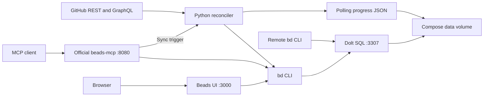

# beads-hub

A shared [Beads](https://github.com/gastownhall/beads) backlog for GitHub issues and pull requests across repositories. Bring open work into one place, group it by repository, and use Beads labels, priorities, dependencies, and claims to decide what to do next.

GitHub supplies source facts; Beads stores local triage and workflow decisions. Work with the backlog through the `bd` CLI, the official beads-mcp server, or [Beads UI](https://github.com/mantoni/beads-ui). The hub reads GitHub; changing a bead never updates the upstream issue or PR.

## Contents

- [What it does](#what-it-does)
- [Architecture](#architecture)
- [Work items and metadata](#work-items-and-metadata)
- [How synchronization works](#how-synchronization-works)
- [Quick start](#quick-start)
- [Local Dolt and stdio](#local-dolt-and-stdio)
- [Docker Compose deployment](#docker-compose-deployment)
- [Configuration](#configuration)
- [Triage and agent access](#triage-and-agent-access)
- [Operations and troubleshooting](#operations-and-troubleshooting)
- [Python package and development](#python-package-and-development)
- [Current scope and validation](#current-scope-and-validation)

## What it does

- Collects issues and PRs from selected users, organizations, and explicit repositories, including private repositories visible to the credential.
- Treats issues and PRs as peer Beads tasks, with repository labels for filtering and local labels for classification.
- Attaches author, assignee, milestone, date, repository, and PR review/CI/branch metadata to each bead.
- Surfaces PRs needing attention alongside issues, and creates blocking dependencies from GitHub's recognized closing references.
- Polls incrementally, refreshes open PR signals independently, and repairs coverage with periodic full scans.
- Preserves local priorities, claims, notes, comments, categories, and unrelated metadata while refreshing source-owned fields.

For example, an issue and its proposed fix can both appear in the backlog. If GitHub recognizes the PR as closing that issue, the issue depends on the PR. Work on failing checks or requested changes through the PR bead while Beads keeps the issue out of the ready queue.

## Architecture

Beads provides the task and dependency layer; Dolt provides its SQL storage. Native local mode opens an embedded database inside the repository. The optional Docker Compose deployment shares one SQL server across CLI, UI, and network MCP clients. The diagram below shows that centralized deployment:



| Compose service | Responsibility | Startup dependency |
| --- | --- | --- |
| `dolt` | Run the SQL server and publish localhost UI, MCP, and SQL ports | None |
| `hub` | Initialize Beads, provision remote SQL access, and run Beads UI | Healthy Dolt |
| `beads-mcp` | Serve official MCP tools/resources and `trigger_github_sync` | Healthy hub |
| `github-reconciler` | Run the continuous GitHub polling loop | Healthy hub |

The reconciler uses GitHubKit for authenticated REST/GraphQL requests and pagination. Beads mutations go through its supported `bd` CLI. The hub retains the official beads-mcp server instance and adds a sync trigger rather than duplicating its tool definitions.

UI, MCP, and sync share the Dolt container's network namespace so internal SQL clients use its loopback interface. Published ports belong to the `dolt` service and bind to the Docker host's `127.0.0.1`. External SQL clients use the password-protected `beads` account, whose grants are limited to the `beads_hub` database.

The named `data` volume mounts at `/var/lib/beads` in each service:

| Workspace path | Purpose |
| --- | --- |
| `.beads/` | Beads workspace configuration and database connection metadata |
| `dolt/` | Dolt database files |
| `.github-sync-state.json` | Repository checkpoints, successful coverage times, errors, and API cooldown |
| `.github-sync.lock` | Shared advisory lock for periodic, manual, and MCP-triggered sync |

Work items live in Dolt; the JSON file stores polling progress. There is no separate GitHub mirror database. `task down` retains the volume. See [architecture and contracts](docs/architecture.md) for storage, concurrency, and failure details.

## Work items and metadata

### Identity and repository grouping

Each repository gets a Beads `epic` titled `OWNER/REPO`. Its imported issues and PRs start as `task` children, distinguished by labels and an external reference:

| GitHub source | External reference | Example labels |
| --- | --- | --- |
| Repository | `gh:OWNER/REPO#repository` | `repo:OWNER/REPO`, `type:repository` |
| Issue | `gh:OWNER/REPO#issue:NUMBER` | `repo:OWNER/REPO`, `type:issue` |
| Pull request | `gh:OWNER/REPO#pr:NUMBER` | `repo:OWNER/REPO`, `type:pr`, `ci:failing` |

Stable GitHub node IDs are recorded in `metadata.hub`, alongside repository identity, source kind, number, state, and managed dependencies. Repository renames refresh the readable reference and repository label while retaining the Beads identity.

Existing imports gain their repository parent on the next successful sync, including closed items absent from a delta. Sync maintains epic type and child parenting. Epic status and local planning fields remain local; empty or excluded repositories are not automatically closed.

GitHub labels use the `github:` namespace and percent-encoded names: `bug` becomes `github:bug`, and `help wanted` becomes `github:help%20wanted`. Local classifications use other labels, such as `category:documentation` or `category:dependency-upgrade`.

### Source facts and local decisions

| Information | Owner and update behavior |
| --- | --- |
| Title, description, source link | Refreshed from GitHub; descriptions include an attention summary, linked table, and original body |
| Repository, source labels, PR signals | Sync-owned `repo:`, `type:`, `github:`, `ci:`, `conflict:`, `review:`, `draft:`, `size:`, `author:`, `links:`, and `resolution:` labels |
| GitHub metadata | Refreshed under `metadata.hub.github` |
| Priority, Beads assignee, notes, comments, local labels and issue/PR type | Local workflow; retained by sync |
| Repository epic type and imported issue/PR parent | Maintained by sync |
| Status | Automatically selected while still sync-managed; claims and manual overrides are preserved |
| Upstream closure | Explicit GitHub `CLOSED` or `MERGED` closes the bead, including locally claimed work |

GitHub assignees are source metadata; they do not claim a bead. Put durable local reasoning in notes or comments, since source text is refreshed. Add `hub:manual-status` to opt out of automatic open/in-progress selection. Verified upstream closure still applies. A local close never closes GitHub and does not stop source-state verification.

The source snapshot includes:

- **People and planning:** author login/type, author association, GitHub assignees, milestone, and requested reviewers.
- **Lifecycle and conversation size:** created/updated/closed dates, closure reason, comment count, and lock state.
- **Repository context:** visibility, default branch, primary language, stars, and fork flag.
- **PR evidence:** draft/mergeability/review/CI state, head/base branches and SHAs, additions/deletions/files/commits, cross-repository flag, and merge date.

Reviewer details are bounded to 100 with explicit total/coverage fields. Closing-issue references are fully paginated. Comment bodies, diffs, full source payloads, and event history are not imported. See the [metadata contract](docs/architecture.md#source-metadata) for exact fields and observation semantics.

Descriptions link to GitHub items/repositories, authors and assignees, milestones, requested reviewers/teams, fork-aware branch snapshots, PR checks/review pages, and closing issues. Generated table text is escaped; the original GitHub body remains intact below a separator. The `size:s/m/l` filters describe added+deleted lines (under 100 / 100–499 / 500+). `author:bot`, `links:closing-issue`, and `resolution:merged`/`resolution:not-planned` expose additional factual queues. These fields use existing source requests and preserve local priority and categories. See [triage usage](docs/usage.md#operate-and-triage).

### PR readiness and dependencies

Automatic PR status follows a deterministic triage policy:

| Signal | Automatic status and labels |
| --- | --- |
| Failed or unknown checks | `open`, with `ci:failing` or `ci:unknown` |
| Merge conflict or unknown mergeability | `open`, with `conflict:true` or `conflict:unknown` |
| Changes requested | `open`, with `review:changes-requested` |
| Non-draft PR without approval | `open`, with `review:needed` |
| No actionable signal above | `in_progress`; pending checks and draft state remain labeled |

An approved PR with passing checks waits in progress; a failing PR becomes ready for attention if it has no blockers. These signals aid triage and do not prove that every repository merge requirement is satisfied.

GitHub's `closingIssuesReferences` determines which issues a PR blocks. The dependency direction is `bd dep add ISSUE_ID PR_ID`: the issue depends on the PR. Both items must be indexed. Removed references prune hub-owned edges; manual dependencies are retained. A closed PR ceases blocking through Beads' normal readiness rules, while the issue's own GitHub state determines whether it closes.

Beads derives readiness from dependencies. A blocked issue can still have stored `status=open`; use `bd ready` and `bd blocked` to inspect the queues.

## How synchronization works

The worker starts after hub readiness and pauses 120 seconds after each pass by default. A few-minute freshness target depends on pass duration and API availability.

1. **Discover repositories.** Resolve and fully paginate configured inventories, deduplicate by repository node ID, and exclude archived/disabled repositories. GitHub search is not used for enumeration.
2. **Read source changes.** Bootstrap with open work. Later polls read all-state issue/PR updates since the last committed repository pass start, overlapping by five minutes.
3. **Refresh open PR evidence.** Independently read known source-open PRs, including checks, reviews, mergeability, and closing references, even when the REST delta is empty.
4. **Repair coverage.** Hourly, on repository rename, or with `--full`, also read the full open backlog and explicitly verify missing imported items. Repairs retain the all-state delta so work created and closed between polls is still covered.
5. **Apply validated snapshots.** Finish each repository's reads before writes, deduplicate source identities, update changed source-owned fields, and reconcile managed dependencies.
6. **Commit progress.** Advance a repository's checkpoint only after its work-item and graph updates succeed. Save successful results together in one atomic progress-file replacement; failed repositories keep their previous checkpoints.

Absence, inaccessible data, and failed pages never prove closure. Partial database writes can be replayed on the next pass, and a crash before the progress commit safely replays the unfinished range. A failed repository does not prevent another successful repository from advancing.

Unchanged snapshots avoid repeat Beads mutations. Source reads are serial by default; `GH_SYNC_WORKERS=2` through `4` can overlap independent node reads. Workers finish before serial Beads/graph writes. Rate-limit deadlines persist across restarts and suppress requests until the cooldown expires. There is no background MCP task or async scheduler.

Bootstrap excludes old closed history. After bootstrap, all-state deltas can discover work created and closed between polls, but the hub is not a complete event log or a point-in-time GitHub snapshot. See [polling contracts](docs/architecture.md#incremental-polling-and-progress) for overlap, repair, and failure boundaries.

## Quick start

The default local setup needs Python 3.11+, uv, and native Beads `bd` 1.3.1 with embedded Dolt support. Its database lives inside the repository. The embedded engine ships with `bd`; a separate Dolt executable or SQL server is not required.

```sh
git clone https://github.com/jufty-bot/beads-hub.git
cd beads-hub
uv sync --locked
bd init --prefix hub --non-interactive --skip-agents --skip-hooks

# Inject a GitHub read credential securely before starting the poller.
: "${GH_TOKEN:?Inject a GitHub read credential}"
export GH_SYNC_QUERY='user:@me'
uv run --locked beads-hub-sync --loop --interval 120
```

Use a fresh Beads workspace for initialization. The credential needs read access to selected repositories and their issues, PRs, checks, and commit statuses, including private/organization access where needed. Sync authenticates directly through GitHubKit; GitHub CLI login is not used. Keep credentials out of committed files and command history.

From another terminal in the initialized repository, inspect progress with `uv run --locked beads-hub-sync --status`. Configure an MCP client to launch `uv run --locked beads-hub-mcp`, which defaults to stdio. The [local guide](docs/local.md) includes a copyable client configuration and instructions for keeping code and data in separate repositories.

## Local Dolt and stdio

Native `bd` opens `.beads/embeddeddolt/` directly for each operation. The Python commands default to the current repository; `BEADS_WORKING_DIR` can select another initialized workspace. All pollers and clients use the same workspace so they share sync locking and checkpoints.

| Component | Lifetime |
| --- | --- |
| `.beads/embeddeddolt/` | Persistent local SQL database, opened directly by `bd` |
| `uv run --locked beads-hub-sync --loop --interval 120` | One background poller while automatic GitHub updates are wanted |
| `uv run --locked beads-hub-mcp` | Stdio session started and stopped by each MCP client |

The database stays on disk when both processes exit. Closing a client leaves polling independent, and reopening a client requires no database initialization. The stdio wrapper retains the official Beads tools and the hub's sync trigger. See [local setup and client configuration](docs/local.md#3-connect-a-stdio-mcp-client) for details. Existing SQL-server workspaces retain their configured backend; this default change does not migrate their data.

## Docker Compose deployment

For centralized access through UI, HTTP MCP, and remote SQL clients, use the four-service Compose stack. It needs Git, Docker Engine with the Compose plugin, and [Task](https://taskfile.dev/); Docker supplies its runtime tools. From the checkout, securely inject both credentials before starting:

```sh
: "${GH_TOKEN:?Inject a GitHub read credential}"
: "${BEADS_REMOTE_PASSWORD:?Inject the remote SQL account password}"
export GH_SYNC_QUERY='user:@me'
task validate
task deploy
```

`task deploy` builds the unified image locally and waits for healthy services. The direct equivalent is `docker compose up -d --build --wait --wait-timeout 180`. No image registry is required.

| Interface | Default host endpoint |
| --- | --- |
| Web UI | `http://127.0.0.1:3000` |
| Streamable HTTP MCP | `http://127.0.0.1:8080/mcp` |
| Dolt SQL | `127.0.0.1:3307` |

Check the initial import with `task sync-status` and `docker compose logs --tail=20 github-reconciler`. A healthy database does not establish GitHub freshness.

## Configuration

Inject configuration into the environment used by Compose. Its default project is `beads-hub`, with persistent data in `beads-hub_data`.

| Variable | Default | Purpose |
| --- | --- | --- |
| `GH_TOKEN` | Empty | GitHub read credential; required for sync, optional for offline UI/MCP use |
| `BEADS_REMOTE_PASSWORD` | Required in Compose | Nonempty password for the database-scoped remote SQL user `beads` |
| `GH_SYNC_QUERY` | `user:@me` | Semicolon-separated repository inventory scopes |
| `GH_SYNC_INTERVAL` | `120` | Positive pause in seconds after each automatic pass |
| `GH_SYNC_WORKERS` | `1` | Independent GitHub node-read workers, from 1 to 4 |
| `BEADS_UI_PORT` / `BEADS_MCP_PORT` / `BEADS_SQL_PORT` | `3000` / `8080` / `3307` | Host ports; container ports remain fixed |
| `MCP_TRANSPORT` | `stdio` locally; `streamable-http` in Compose | MCP client transport; use `sse` for legacy `/sse` |
| `BEADS_WORKING_DIR` | Current directory locally; `/var/lib/beads` in Docker | Initialized repository holding the database, lock, and progress |
| `IMAGE` | `beads-hub:test` | Shared image tag; with Task, select it using `IMAGE=...` as a task variable |

Supported scopes are inventory selectors, rather than arbitrary search queries:

| Scope | Coverage |
| --- | --- |
| `user:@me` | Repositories owned by the authenticated user, including accessible private ones |
| `user:NAME` | Repositories in GitHub's public user listing |
| `org:NAME` | Organization repositories visible to the credential |
| `repo:OWNER/REPO` | One explicit accessible repository |

For example, set `GH_SYNC_QUERY='user:@me;org:example-team;repo:another-owner/project'` for overlapping scopes; duplicates are imported once. Both issues and PRs are always included. Search qualifiers such as `label:` or `is:open` are rejected.

For a selected run, use `uv run --locked beads-hub-sync --repo example/api --repo example/web`, or `task sync-now -- --repo example/api --full` in Compose. Repeated `--repo` flags replace configured scopes for that command and also work with `--loop`. MCP clients can call `trigger_github_sync` with `{"repositories": ["example/api", "example/web"]}`; omitting the list uses configured scopes. Unselected imports and checkpoints are retained. To persist selection for the periodic worker, configure `GH_SYNC_QUERY` with explicit `repo:` scopes. See [repository selection](docs/usage.md#select-repositories).

The SQL password must remain available when loading Compose configuration for operational tasks. `task validate` uses the quiet Compose check so credentials are not printed. See [deployment guidance](docs/usage.md#deploy-with-docker-compose) for custom image tags, password rotation, and port configuration.

## Triage and agent access

### Beads CLI

For shell-capable agents, use the matching `bd` CLI (currently `1.3.1`) from the initialized local repository. For centralized SQL access, create the [Compose pointer workspace](AGENTS.md#compose-sql-clients). Then filter and triage through Beads:

```sh
bd ready --label 'repo:example/orbit' --json
bd ready --label 'type:pr,ci:failing' --json
bd list --label 'type:issue' --json
bd blocked --json

# Replace the example ID with a bead from the hub.
bd update hub-example --claim
bd update hub-example --priority 1 --add-label category:bug-fix
bd comments add hub-example 'Investigate failing checks and record the next action'
bd show hub-example --json
```

Priority and categories are local choices. Repository labels provide grouping; `metadata.hub.github` provides source context for more detailed classification. No model or automatic category assignment runs in the hub.

### MCP

For the local default, use the [stdio client configuration](docs/local.md#3-connect-a-stdio-mcp-client). For Compose, connect to the running HTTP server:

```json
{
  "mcpServers": {
    "beads": {
      "url": "http://127.0.0.1:8080/mcp"
    }
  }
}
```

The official server provides tools such as `ready`, `list`, `show`, `create`, `claim`, `update`, `close`, `reopen`, `dep`, and comments, plus `beads://quickstart`. Use its tool discovery for exact schemas. The added `trigger_github_sync` tool runs a synchronous reconciliation under the same lock as the worker and returns `complete`, `partial`, or `busy`. See [agent connections](AGENTS.md#mcp-agents) for stdio and context-routing details.

## Operations and troubleshooting

For the local workspace, use `uv run --locked beads-hub-sync --status` and `uv run --locked beads-hub-sync --full`. The Task commands below operate the Compose deployment:

```sh
task sync-now
task sync-now -- --full  # Repair open coverage and retain pending all-state changes
task sync-status        # Inspect repository coverage, errors, and cooldowns
docker compose logs --tail=20 github-reconciler
docker compose ps
task down               # Stop services while retaining the data volume
```

| Symptom | What to inspect |
| --- | --- |
| Containers are healthy, but GitHub changes are missing | Repository `last_success_at`, `error`, and global `retry_at` in `task sync-status`; reconciler logs |
| Sync returns `partial` | Reported repository/API/database/graph errors; failed checkpoints remain unchanged for replay |
| Sync returns `busy` | Another periodic, manual, or MCP-triggered pass owns the shared lock |
| A repository is absent | Scope choice, credential visibility, organization access, and archived/disabled state; absence never closes its beads |
| UI has not reflected a remote CLI edit | Refresh the browser; the pinned UI watches workspace files and may miss external SQL-backed changes |

Progress includes `checkpoint` (the committed pass start), `last_full_at`, and `last_success_at` as UTC Unix timestamps. Pass summaries include full/delta `modes`, processed item counts, and successful mutating CLI command count in `writes`. Processed counts are not portfolio totals.

Use repository coverage times to judge freshness. A bead's `metadata.hub.github.observed_at` intentionally stays unchanged when source facts are unchanged. Source facts retained from an earlier REST observation can coexist with freshly read PR evidence. Database health checks alone do not detect stale GitHub coverage; automatic freshness alerts are not implemented.

Ports are published on localhost. UI/MCP have no built-in authentication, and SQL has no TLS configured. Use private tunnels or your own authenticated network boundary for remote access. The official MCP context tools can change workspace routing; this deployment is for trusted clients sharing one backlog.

Keep one instance of each service. Bring the full stack up together when replacing Dolt because other services share its network namespace. Restart policies restart exited processes; an unhealthy running container does not automatically restart. Back up the workspace and database together and test restoration before relying on it. See [operating guidance](docs/usage.md#operate-and-triage) for details.

## Python package and development

Application code lives in `src/beads_hub` and uses the `uv_build` backend. Development installs are editable; Docker installs the package non-editable with locked runtime dependencies.

```text
src/beads_hub/
├── __init__.py
├── github.py       # GitHubKit requests, pagination, source snapshots, bounded reads
├── description.py  # Linked Markdown tables, source escaping, attention summaries
├── sync.py         # Beads CLI adapter, ownership rules, reconciliation, polling CLI
├── state.py        # Incremental cursors, repair selection, atomic progress persistence
├── runtime.py      # Startup readiness and database-scoped SQL account setup
└── mcp.py          # Official MCP instance, transport startup, synchronous sync trigger
scripts/            # Shell startup and disposable smoke helpers
tests/              # Offline source/CLI/reconciliation tests and runtime smoke checks
compose.yaml        # Four-service deployment and persistent volume
Dockerfile          # Unified runtime image
Taskfile.yaml       # Development, packaging, deployment, and operational tasks
pyproject.toml      # Package metadata, commands, dependencies, and quality settings
uv.lock             # Locked Python dependency resolution
```

| Installed command | Purpose |
| --- | --- |
| `beads-hub-sync` | One-shot/periodic reconciliation, `--full` repair, and `--status` |
| `beads-hub-mcp` | Start the official MCP stdio/HTTP/SSE server after hub readiness |
| `beads-hub-runtime` | Wait for SQL/hub readiness or provision the remote SQL account |

Use Task for the same flags and environment as the project workflows:

```sh
task install    # uv sync --locked
task fix        # Formatting and lint fixes
task lint       # Formatting, lint, and shell syntax checks
task check      # Strict Python types
task test       # Token-free behavior tests
task package    # uv source distribution and wheel in dist/
task smoke-local  # Native bd: disposable embedded database and concurrent stdio/polling
task smoke        # Build and exercise a disposable Compose stack

task run -- beads-hub-sync --help
uv run --locked beads-hub-sync --status
```

Running sync or MCP locally requires an initialized hub and the matching `bd` CLI. `--status` reads progress without contacting GitHub. Tests import the installed package without source-path overrides. Add dependencies with `uv add`, commit `uv.lock`, and use `task lock` when intentionally refreshing resolution. `task build` builds the Docker image; `task package` builds Python distributions.

The smoke workflow uses synthetic GitHub records with real Beads, Dolt, UI, and MCP processes. It creates an isolated Compose project and volume, uses temporary localhost ports, verifies restart persistence, and removes its test resources on exit. Do not run `tests/smoke_runtime.py` against a real backlog: it deliberately writes synthetic work items.

## Current scope and validation

The current implementation has 129 passing offline tests, source/wheel build validation, native ARM64 macOS and AMD64 Linux embedded Dolt/concurrent polling/stdio/persistence validation, and linked-table Markdown/sanitization checks. A prior ARM64 Compose smoke pass covers installed commands, Beads lifecycle/graph behavior, UI WebSocket delivery, official MCP tools/resources over HTTP and stdio, authenticated remote SQL, and restart persistence. The updated repository epic and linked-description assertions await a Compose rerun because Docker is unavailable in the current validation environment. GitHub HTTP tests use synthetic responses. A credentialed multi-repository pilot, AMD64 image build, full browser interaction suite, and backup/restore exercise remain unverified.

Current boundaries include polling rather than webhooks, one shared backlog rather than tenant isolation or HA, selected source snapshots rather than complete conversations/diffs/history, and human/agent categorization rather than automatic classification. There is no GitHub write-back, automatic freshness alerting, or migration from the earlier SQLite application.

- [Architecture and synchronization contracts](docs/architecture.md)
- [Usage and deployment](docs/usage.md)
- [Local Dolt and stdio setup](docs/local.md)
- [Agent connections](AGENTS.md)
- [Design decisions](docs/decisions.md)
- [Roadmap](docs/roadmap.md) and [validation checklist](docs/checklist.md)

This standalone project began as a redesign of [gh-maintainer](https://github.com/jufty-bot/gh-maintainer). The earlier application and its history remain in that repository.
