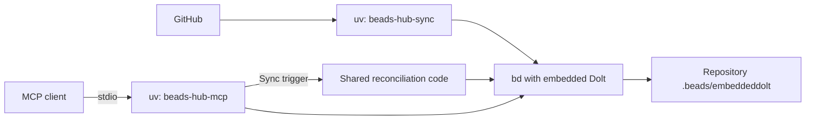

# Local embedded Dolt and stdio MCP

The default local workflow stores the backlog inside a repository under `.beads/embeddeddolt/`. The native `bd` binary opens embedded Dolt directly. The uv poller and each stdio MCP session use that same workspace, with no Docker, SQL listener, separate `dolt` executable, or SQL credentials required.



## Prerequisites

Install Python 3.11+, uv, and [Beads 1.3.1](https://github.com/gastownhall/beads/releases/tag/v1.3.1) with embedded Dolt support. The tested macOS ARM64 release includes it; embedded support requires a CGO-enabled Beads build. Put `bd` on your shell's `PATH`. uv installs the Python dependencies, while the embedded database engine is part of `bd`.

From the beads-hub checkout:

```sh
uv sync --locked
```

## 1. Initialize the repository once

The checkout itself can hold your hub's local backlog:

```sh
bd init --prefix hub --non-interactive --skip-agents --skip-hooks
bd info --json
```

Run this in a repository that does not already have a Beads workspace. Plain `bd init` selects embedded mode; leave `--server`, `--external`, and SQL connection settings out. Use a clean environment without `BEADS_DIR` or `BEADS_DOLT_SERVER_*` settings left over from a server setup.

The local layout is:

```text
your-repository/
├── .beads/
│   ├── metadata.json      # Workspace identity and embedded backend configuration
│   └── embeddeddolt/      # Local Dolt database files
├── .github-sync-state.json
└── .github-sync.lock
```

The beads-hub checkout ignores these paths in Git. When using another repository, add the same paths to its ignore rules. Dolt maintains its own database history; preserve the database files and workspace metadata together for backups.

## 2. Run the GitHub poller

Inject `GH_TOKEN` securely into the poller's environment, then run from the initialized repository root:

```sh
: "${GH_TOKEN:?Inject a GitHub read credential}"
export GH_SYNC_QUERY='user:@me'
uv run --locked beads-hub-sync --loop --interval 120
```

Keep one poller running while you want automatic updates. The CLI defaults to the current repository for database access, sync locking, and progress. Use `--interval` for the native pause; `GH_SYNC_INTERVAL` configures the Compose command. Repository scopes, incremental reads, PR evidence refresh, and local-field ownership are the same in both deployments.

To sync only named repositories, set `GH_SYNC_QUERY='repo:example/api;repo:example/web'` or pass repeated `--repo` flags, for example `uv run --locked beads-hub-sync --repo example/api --repo example/web --loop`. Flags replace configured scopes for that process. Each selected GitHub repository becomes an epic containing its imported issues and PRs. See [selection and epic behavior](usage.md#select-repositories).

From another terminal in that repository:

```sh
uv run --locked beads-hub-sync --status
uv run --locked beads-hub-sync --full
bd ready --label 'type:pr' --json
```

One-shot source sync requires `GH_TOKEN`; progress inspection and reading existing work do not. For a repository other than the code checkout, select the installed project without changing the working directory:

```sh
uv run --project /absolute/path/to/beads-hub --locked beads-hub-sync --status
```

Alternatively, set `BEADS_WORKING_DIR` to the absolute path of the initialized repository. Use the same workspace for every poller, CLI call, and MCP session so they share the lock and checkpoints. A shared hub can still import work from many GitHub repositories into this one local database.

## 3. Connect a stdio MCP client

Configure your client to launch the wrapper through uv. `BEADS_WORKING_DIR` points to the repository holding the database, which may be different from the code checkout selected by `--project`:

```json
{
  "mcpServers": {
    "beads": {
      "command": "uv",
      "args": [
        "run", "--project", "/absolute/path/to/beads-hub",
        "--locked", "beads-hub-mcp"
      ],
      "env": {
        "BEADS_WORKING_DIR": "/absolute/path/to/your-repository",
        "BEADS_PATH": "/absolute/path/to/bd",
        "BEADS_ACTOR": "local-agent",
        "GH_SYNC_QUERY": "user:@me"
      }
    }
  }
}
```

Replace all example paths with actual absolute paths; client environment values do not automatically expand `$HOME` or `~`. Use an absolute `command` path if the client cannot find uv. Stdio is the wrapper's default transport; `MCP_TRANSPORT=stdio` can also select it explicitly. The normal terminal command is:

```sh
uv run --locked beads-hub-mcp
```

The command expects an MCP client on stdin/stdout. It starts no HTTP listener, and runtime logs use stderr. Startup checks database access through `bd info`, which works with either embedded or server-backed workspaces. The official tools, `beads://quickstart`, and synchronous `trigger_github_sync` tool remain available.

To enable the trigger, inject `GH_TOKEN` through the client's secret/environment facility and match `GH_SYNC_QUERY` to the poller. Without a token, ordinary Beads tools still work and the trigger reports an authentication error. Polling runs independently of whether an MCP client is open.

## Concurrency, shutdown, and persistence

Each `bd` process opens the embedded database for its operation. The pinned Beads driver coordinates database access; the hub's filesystem lock separately serializes reconciliation passes. MCP reads and ordinary Beads CLI edits can run while the poller updates source snapshots. A simultaneous sync trigger returns `busy` when the poller owns the lock.

Stop the poller with Ctrl-C and close stdio sessions through their MCP client. Later, restart polling and reconnect clients in the same repository. There is no database server process to restart and no reinitialization is needed. Work items and polling progress remain on disk.

## Existing server workspaces and Compose

Existing server-mode metadata keeps using its configured SQL server. The local default change does not convert or move that database. Keep the existing connection settings for those workspaces; use a fresh repository for the embedded workflow until choosing an explicit data migration.

For centralized access, the [Compose deployment](usage.md#deploy-with-docker-compose) still runs one shared Dolt SQL server and HTTP/SSE MCP. A host-side stdio client can connect through the dedicated remote pointer in [AGENTS.md](../AGENTS.md#compose-sql-clients). Such a pointer has its own lock/progress files, so run source reconciliation inside Compose through `task sync-now` or its HTTP MCP trigger.

## Validation

`task smoke-local` uses native `bd` to initialize an isolated temporary Git repository. It exercises real embedded writes, dependencies, no-op reconciliation, overlapping poller writes and stdio MCP reads, shared trigger locking, and persistence across new client processes. It uses synthetic GitHub data and requires neither Docker nor a GitHub credential. Set `BEADS_PATH` if the tested native binary is not on `PATH`.

The offline suite covers current-repository defaults and installed stdio startup with and without explicit environment settings. `task smoke` separately verifies the Compose SQL/HTTP/stdio workflow. Native embedded validation currently covers ARM64 macOS with the pinned Beads release; other native platforms and credentialed GitHub behavior remain unverified.
