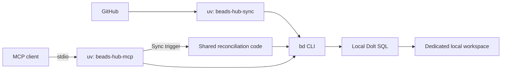

# Local Dolt and stdio MCP

Run the shared backlog on your workstation with native Dolt, Beads, and uv. The database and periodic poller run independently; each MCP client starts its own stdio server against that same workspace. Docker and the web UI are optional for this workflow.



## Prerequisites

Install Python 3.11+, uv, [Beads 1.3.1](https://github.com/gastownhall/beads/releases/tag/v1.3.1), and [Dolt 2.5.1](https://github.com/dolthub/dolt/releases/tag/v2.5.1). Put `bd` and `dolt` on your shell's `PATH`. These are the versions exercised with the pinned `beads-mcp` package; uv installs Python dependencies, not the native binaries.

From the beads-hub checkout:

```sh
uv sync --locked
```

## 1. Choose one dedicated workspace

Use a fresh directory for this backlog. Keep these workspace and SQL settings consistent across terminal sessions and MCP clients:

```sh
export BEADS_WORKING_DIR="$HOME/.local/share/beads-hub"
export BEADS_DIR="$BEADS_WORKING_DIR/.beads"
export BEADS_PATH="$(command -v bd)"
export BEADS_DOLT_SERVER_MODE=1
export BEADS_DOLT_SERVER_HOST=127.0.0.1
export BEADS_DOLT_SERVER_PORT=3307
export BEADS_DOLT_SERVER_USER=root
export BEADS_DOLT_AUTO_START=0
export BEADS_ACTOR=local-maintainer
```

Pick an unused port. If a Compose stack already publishes `3307`, choose another port here and use it in the server, initialization, and MCP configuration below.

Keep Dolt's configuration inside this workspace as well. `DOLT_ROOT_PATH` redirects its user configuration, so the following identity setup leaves your usual Dolt configuration intact:

```sh
export DOLT_ROOT_PATH="$BEADS_WORKING_DIR/dolt-config"
mkdir -p "$BEADS_WORKING_DIR/dolt" "$DOLT_ROOT_PATH"
dolt config --global --add user.name beads-hub
dolt config --global --add user.email beads-hub@localhost
```

The layout is `.beads/` for the connection metadata, `dolt/` for SQL data, and `.github-sync-state.json` for polling progress. Keep Dolt's data outside `.beads/dolt`, which Beads interprets as a legacy workspace.

## 2. Start local Dolt

In a terminal with the settings above, run the server in the foreground:

```sh
dolt sql-server --data-dir "$BEADS_WORKING_DIR/dolt" \
  --host "$BEADS_DOLT_SERVER_HOST" --port "$BEADS_DOLT_SERVER_PORT"
```

This setup uses Dolt's local `root` account on a loopback-only listener. It does not provision remote SQL access or require `BEADS_REMOTE_PASSWORD`. Keep the listener on `127.0.0.1` for this trusted local workflow; the [Compose setup](usage.md#deploy-with-docker-compose) provisions a separate account for remote clients.

## 3. Initialize Beads once

In another terminal with the same workspace/SQL environment, initialize the fresh workspace against the running server:

```sh
(
  cd "$BEADS_WORKING_DIR"
  bd init --server --external \
    --server-host "$BEADS_DOLT_SERVER_HOST" \
    --server-port "$BEADS_DOLT_SERVER_PORT" \
    --server-user "$BEADS_DOLT_SERVER_USER" \
    --database beads_hub --prefix hub \
    --non-interactive --skip-agents --skip-hooks
)
uv run --locked beads-hub-runtime
bd info --json
```

Run initialization only for the new workspace. Later sessions reuse its metadata and database. The `--external` setting and `BEADS_DOLT_AUTO_START=0` keep Dolt's lifetime independent of individual CLI/MCP sessions.

Run uv commands from the checkout, or use `uv --directory /absolute/path/to/beads-hub run --locked ...` from elsewhere. The code checkout and data workspace are separate directories.

## 4. Run the GitHub poller

Inject `GH_TOKEN` securely into this process's environment, then run:

```sh
: "${GH_TOKEN:?Inject a GitHub read credential}"
export GH_SYNC_QUERY='user:@me'
uv run --locked beads-hub-sync --loop --interval 120
```

Keep one poller running while you want automatic updates. The native CLI uses `--interval` for its pause; `GH_SYNC_INTERVAL` configures the Compose command. Repository scopes, incremental checkpoints, PR evidence refresh, rate cooldowns, and local-field ownership are identical in both deployments.

From another terminal with the same workspace/SQL environment:

```sh
uv run --locked beads-hub-sync --status
uv run --locked beads-hub-sync --full
bd ready --label 'type:pr' --json
```

One-shot sync requires `GH_TOKEN`; progress inspection and reading existing Beads work do not. Native processes must share the same workspace path so polling, manual sync, and MCP triggers use the same lock and progress file.

## 5. Connect a stdio MCP client

Configure your client to launch the installed wrapper through uv. Replace every `/absolute/path/...` value with an actual absolute path; MCP environment values do not automatically expand `$HOME` or `~`.

```json
{
  "mcpServers": {
    "beads": {
      "command": "uv",
      "args": [
        "--directory", "/absolute/path/to/beads-hub",
        "run", "--locked", "beads-hub-mcp"
      ],
      "env": {
        "MCP_TRANSPORT": "stdio",
        "BEADS_PATH": "/absolute/path/to/bd",
        "BEADS_WORKING_DIR": "/absolute/path/to/workspace",
        "BEADS_DIR": "/absolute/path/to/workspace/.beads",
        "BEADS_DOLT_SERVER_MODE": "1",
        "BEADS_DOLT_SERVER_HOST": "127.0.0.1",
        "BEADS_DOLT_SERVER_PORT": "3307",
        "BEADS_DOLT_SERVER_USER": "root",
        "BEADS_DOLT_AUTO_START": "0",
        "BEADS_ACTOR": "local-agent",
        "GH_SYNC_QUERY": "user:@me"
      }
    }
  }
}
```

Use an absolute path for `command` as well if your client cannot find uv. To enable `trigger_github_sync`, inject `GH_TOKEN` through the client's secret/environment facility. Without it, the normal Beads tools still read and manage the local backlog, and the trigger reports an authentication error. Match the trigger's `GH_SYNC_QUERY` to the poller's scopes. Polling continues independently of whether an MCP client is open.

`MCP_TRANSPORT=stdio` uses stdin/stdout for MCP messages and starts no HTTP listener. HTTP bind settings are ignored. Startup waits for the initialized hub; the server retains the official tools, `beads://quickstart`, and the synchronous sync trigger. Runtime logs stay on stderr.

For a terminal launch after setting the same environment:

```sh
MCP_TRANSPORT=stdio uv run --locked beads-hub-mcp
```

That command waits for an MCP client speaking the stdio protocol. It is not an interactive chat prompt. Prefer the client configuration above for normal use.

## Shutdown and restart

Stop the poller with Ctrl-C, close MCP sessions through their client, then stop Dolt with Ctrl-C. Start Dolt again against the same data directory, restart the poller, and reconnect clients. No reinitialization is needed; Beads work and polling progress remain on disk. Use your OS process manager if you want Dolt and polling to survive terminal closure.

## Stdio with a Compose-hosted database

A host-side stdio client can also use the existing Compose database. Initialize the dedicated remote pointer described in [AGENTS.md](../AGENTS.md#shell-agents), then use that pointer's absolute workspace/Beads paths and SQL connection environment in the configuration above. Set the SQL user to `beads` and securely inject `BEADS_DOLT_PASSWORD` for the database-scoped account.

The official `beads-mcp` stdio command supports ordinary Beads access to that pointer. The hub wrapper also exposes a sync trigger, but a host pointer has its own lock/progress files: use `task sync-now` or the Compose HTTP MCP trigger to reconcile the Compose workspace. Run only the Compose poller for that database.

## Validation

Offline tests spawn the installed stdio server and discover tools/resources and the sync trigger. The full `task smoke` workflow also exercises stdio against real Dolt/Beads alongside the HTTP checks. A native ARM64 macOS check exercised the pinned binaries, fresh-workspace initialization, real stdio tools/resource/trigger, and database restart persistence with synthetic data. It did not contact GitHub.
